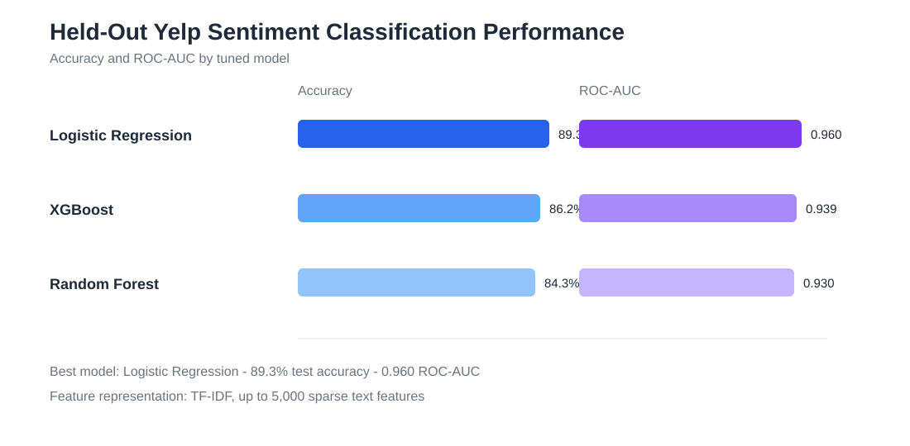

# Yelp Review Sentiment Classification

<p align="center">
  <strong>Binary sentiment classification of Yelp reviews using TF-IDF and supervised machine learning.</strong>
</p>

<p align="center">
  
  
  
  
</p>

<p align="center">
  
</p>

## Overview

This project builds an NLP pipeline to classify Yelp review text as **positive or negative sentiment**.

Reviews are cleaned and transformed with **TF-IDF vectorization**, then evaluated with three supervised-learning approaches:

- Logistic Regression
- Random Forest
- XGBoost

The strongest model was **Logistic Regression**, achieving **89.3% test accuracy** and **0.96 ROC-AUC**.

## Modeling Workflow

```text
Yelp review text
  → text cleaning
  → sentiment label construction
  → TF-IDF vectorization
  → model tuning / training
  → held-out test evaluation
  → model comparison
```

## Labeling Strategy

The analysis converts star ratings into a binary sentiment task:

- **1–2 stars** → negative
- **4–5 stars** → positive
- **3-star reviews** → removed as neutral / ambiguous

Class balance was checked before modeling; oversampling was considered but not retained when it was not needed.

## Model Comparison

| Model | Test Accuracy | ROC-AUC |
|---|---:|---:|
| **Logistic Regression** | **89.3%** | **0.96** |
| XGBoost | 86.2% | 0.94 |
| Random Forest | 84.3% | 0.93 |

Logistic Regression performed best on the high-dimensional sparse TF-IDF representation, where a linear decision boundary was particularly effective.

## Evaluation

Model performance was compared using:

- accuracy
- precision
- recall
- F1-score
- ROC-AUC

The project uses held-out test performance as the primary evidence for model comparison rather than relying on training fit.

## Repository Structure

```text
yelp-sentiment-classification/
├── README.md
├── analysis/
│   └── original_notebook.html
└── figures/
    └── model_comparison.svg
```

## View the Analysis

The original rendered analysis is preserved in `analysis/original_notebook.html`. It contains the preprocessing, exploratory text analysis, TF-IDF feature construction, model tuning, evaluation output, and final comparison.

## Interpretation

The result is a useful reminder that more complex models do not automatically outperform simpler ones. For this sparse text representation, Logistic Regression produced the strongest generalization performance among the tested models.

## Limitations

- Binary labeling removes neutral 3-star reviews and simplifies sentiment.
- Performance reflects the sampled project dataset rather than all Yelp reviews.
- TF-IDF captures term importance but not the full semantic structure of language.
- Manually written example reviews were exploratory checks, not formal generalization evidence.

---

<sub>Graduate machine-learning project, 2026.</sub>
